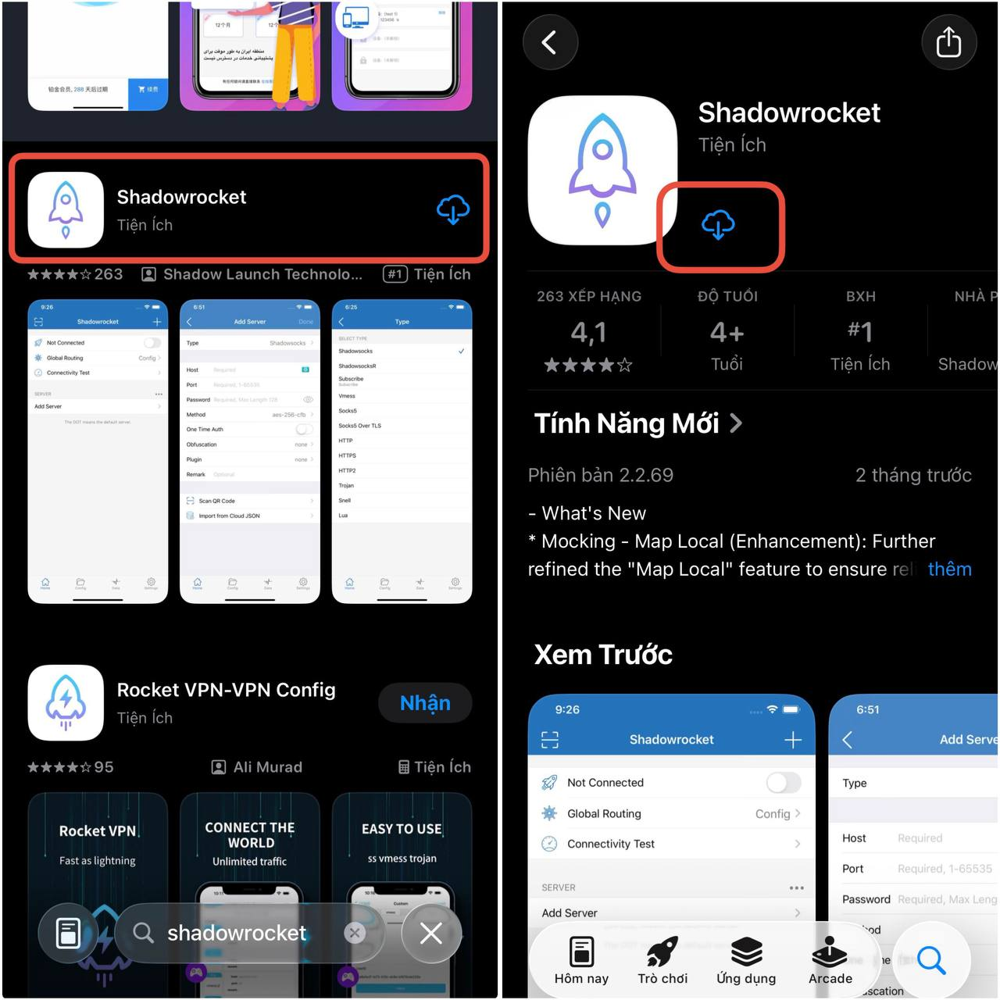
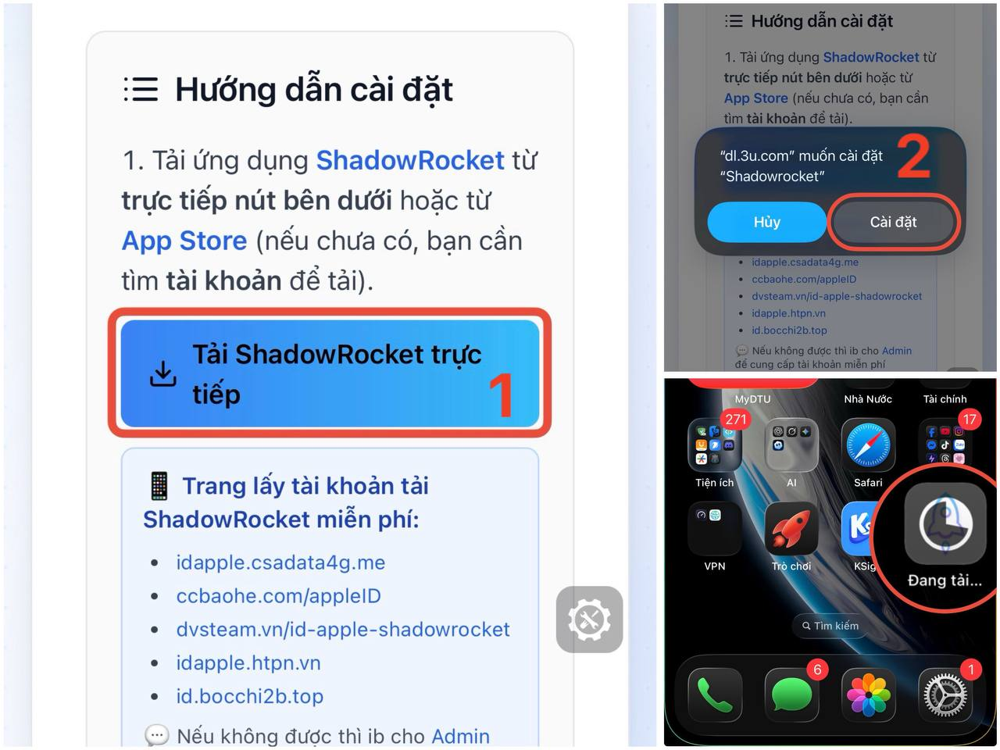
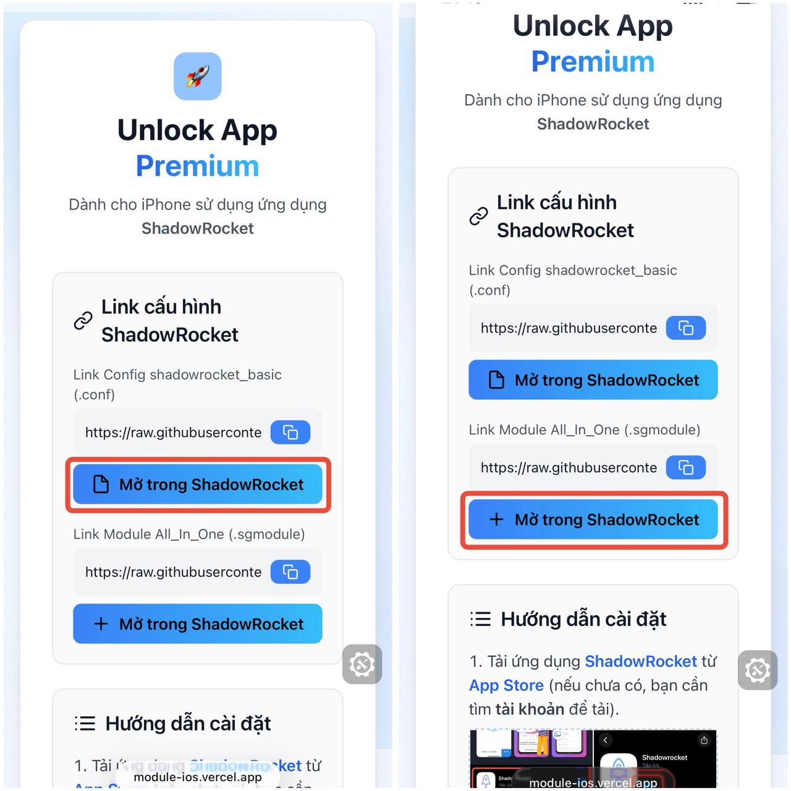
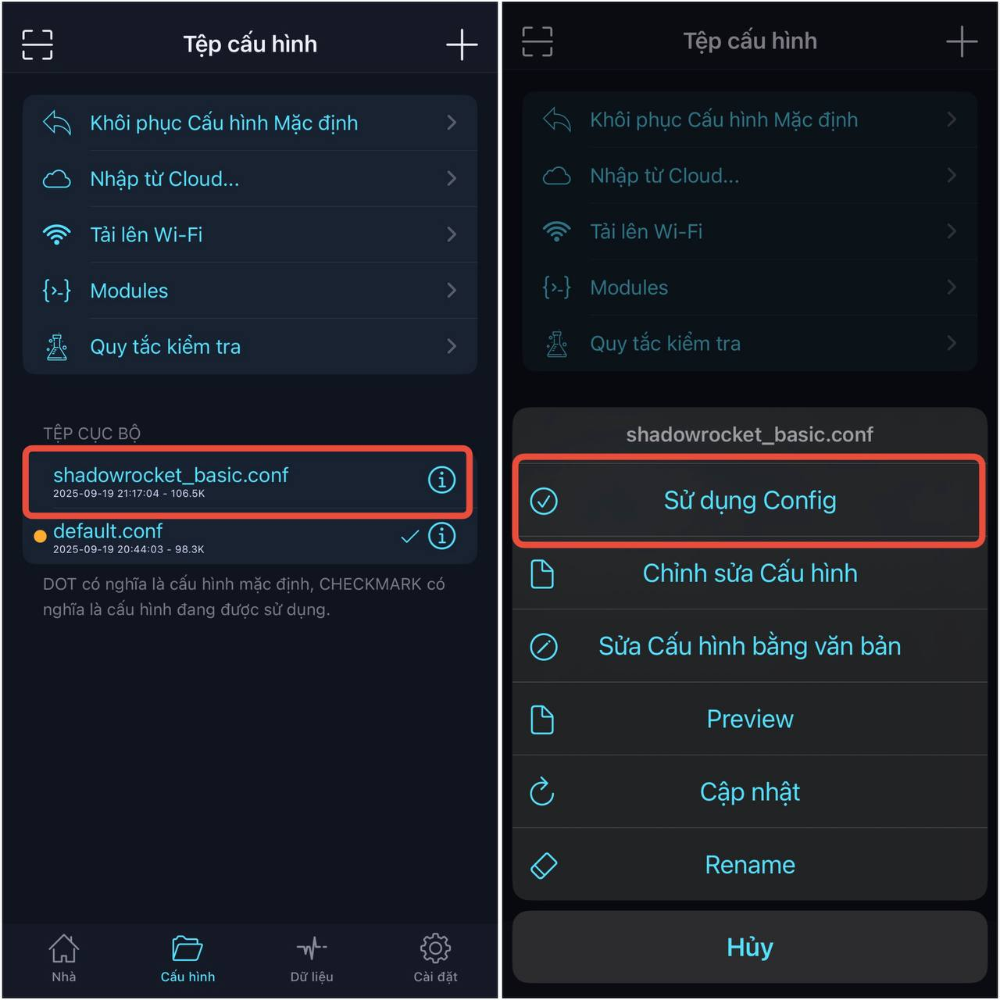
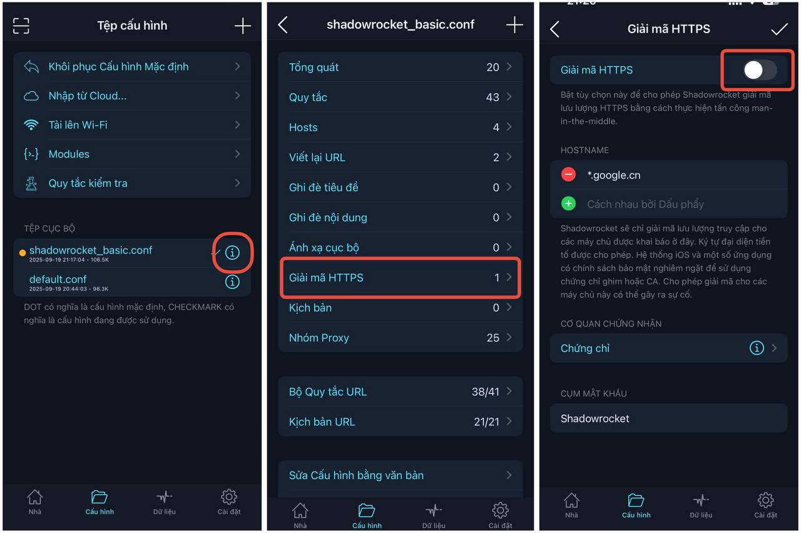
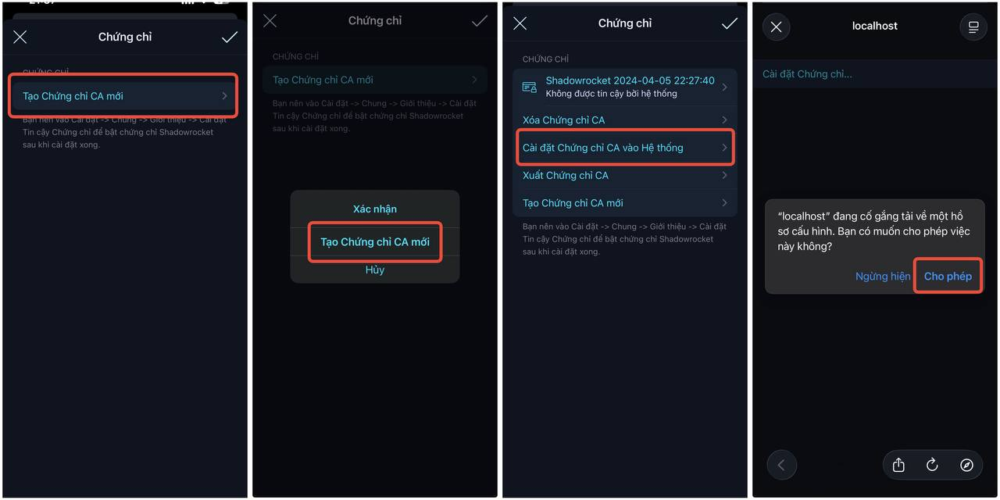
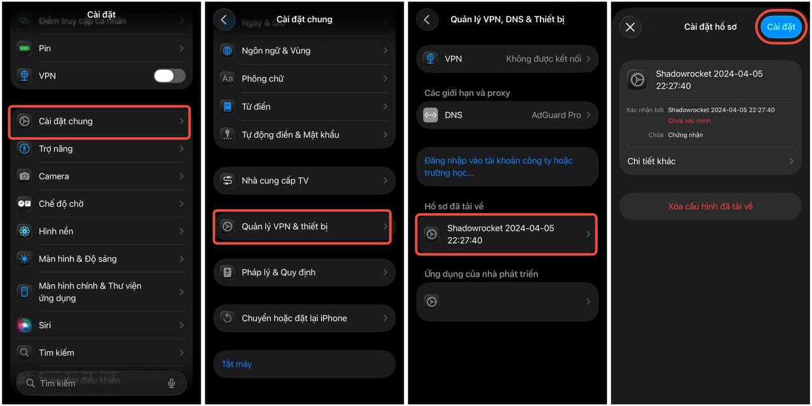
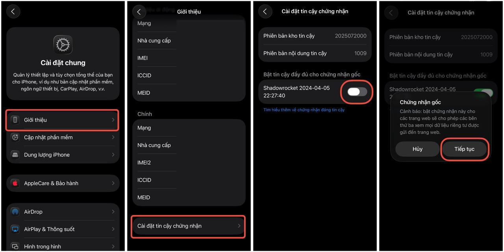
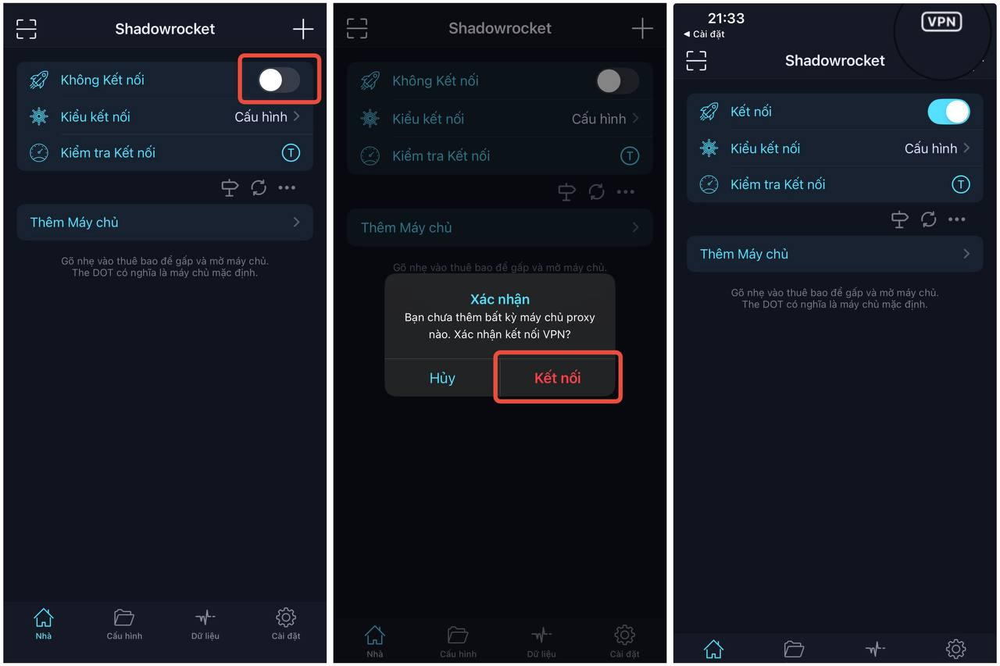

<p align="center">
  <a href="https://raw.githubusercontent.com/duyvinh09/Module_IOS/refs/heads/main/All_In_One.sgmodule">
    
  </a>
  <a href="https://apps.apple.com/app/shadowrocket/id932747118">
    
  </a>
  <a href="https://github.com/duyvinh09">
    
  </a>
</p>

<h1 align="center">iOS Modules for Shadowrocket</h1>

<p align="center">
  A collection of Shadowrocket configurations, modules, and scripts for enabling
  supported <strong>Premium / Pro / VIP</strong> features on iOS applications.
</p>

<p align="center">
  <a href="./README.vi.md">Đọc bằng tiếng Việt</a>
</p>

> [!IMPORTANT]
> This project provides technical configurations for educational and reference
> purposes only. Use them only with applications, accounts, and content you are
> authorized to use. You are responsible for complying with Shadowrocket, App
> Store, and third-party application terms of service.

## Contents

- [Overview](#overview)
- [Requirements](#requirements)
- [Installing Shadowrocket](#installing-shadowrocket)
- [Quick Start](#quick-start)
- [Manual Setup](#manual-setup)
- [Supported Applications](#supported-applications)
- [Repository Structure](#repository-structure)
- [Troubleshooting](#troubleshooting)
- [Contributing](#contributing)

## Overview

This repository contains `.conf`, `.sgmodule`, `.js`, and related configuration
files for [Shadowrocket](https://apps.apple.com/app/shadowrocket/id932747118).
The rules and scripts process application traffic through Shadowrocket's local
proxy. When a compatible configuration is active and the VPN is connected,
supported features may become available in the target application.

For a visual guide, open [`index.html`](./index.html). The complete Vietnamese
documentation is available in [`README.vi.md`](./README.vi.md).

## Requirements

- An iPhone or iPad with Shadowrocket installed.
- A stable Internet connection.
- Permission to install and trust a CA certificate when HTTPS Decryption is used.
- Avoid installing multiple modules that target the same application or rules,
  as they may conflict.

## Installing Shadowrocket

### Option 1: App Store (recommended)

Purchase and install [Shadowrocket from the App Store](https://apps.apple.com/app/shadowrocket/id932747118).
This is the official and most reliable installation method.



### Option 2: 3uTools

If the App Store is not available, you can use a Windows computer and
[3uTools](https://www.3u.com/):

1. Install 3uTools on your computer.
2. Connect the iPhone with a USB cable. Tap **Trust This Computer** on the
   iPhone and enter the device passcode if requested.
3. Wait for 3uTools to detect the device and follow its instructions to install
   the 3uTools app on the iPhone.
4. Open 3uTools on the iPhone, search for `Shadowrocket`, and install it.

> [!WARNING]
> The direct-install button on the visual guide only works after the device has
> been initialized or supported by 3uTools. If it does not work, install
> Shadowrocket from inside the 3uTools app after connecting the iPhone to a
> computer.
>
> Never sign an unknown account into iCloud. If another account is required for
> downloading an app, use it only in the App Store and sign out afterwards.



## Quick Start

`All_In_One` is the recommended starting point when you want to load the
project's supported rules and modules together.

### Config

```text
https://raw.githubusercontent.com/duyvinh09/Module_IOS/refs/heads/main/All_In_One.conf
```

### Module

```text
https://raw.githubusercontent.com/duyvinh09/Module_IOS/refs/heads/main/All_In_One.sgmodule
```

Open them directly from an iOS device with Shadowrocket installed:

- [Open All_In_One.conf in Shadowrocket](shadowrocket://config/add/https://raw.githubusercontent.com/duyvinh09/Module_IOS/refs/heads/main/All_In_One.conf)
- [Install All_In_One.sgmodule in Shadowrocket](shadowrocket://install?module=https%3A%2F%2Fraw.githubusercontent.com%2Fduyvinh09%2FModule_IOS%2Frefs%2Fheads%2Fmain%2FAll_In_One.sgmodule)

If a `shadowrocket://` link does not open, copy the raw URL and add it manually
from the **Configuration** tab.

## Manual Setup

The following steps apply to `All_In_One.conf` and `All_In_One.sgmodule`.
Menu names can vary slightly between iOS and Shadowrocket versions.

### 1. Import the config and module

Open the **Configuration** tab in Shadowrocket:

1. Tap **+**.
2. Paste the `All_In_One.conf` URL and download it.
3. Tap **+** again and add the `All_In_One.sgmodule` URL.



### 2. Select the active config

Select `All_In_One.conf` and tap **Use Config**.



### 3. Enable HTTPS Decryption

Tap the blue information icon next to `All_In_One.conf`, open
**HTTPS Decryption**, and enable it.



### 4. Generate and install the CA certificate

When prompted by Shadowrocket, choose:

1. **Generate a New CA Certificate**.
2. **Install CA Certificate**.
3. Tap **Allow**, then **Close**.



### 5. Install the certificate in iOS Settings

Open **Settings** → **General** → **VPN & Device Management**, then install
the certificate you just generated.



### 6. Trust the certificate

Open **Settings** → **General** → **About** → **Certificate Trust Settings**.
Enable the Shadowrocket certificate and confirm.



### 7. Start the connection

Return to Shadowrocket, open the **Home** tab, and enable **Connection**. The
configuration is active when the **VPN** indicator appears in Control Center.



## Supported Applications

The list below is based on the current project configuration and may change
depending on the application version, server-side changes, or active rules.

| Application | Supported features |
| --- | --- |
| Alight Motion | Pro features, watermark removal |
| BeautyPlus | VIP features |
| CamScanner | VIP features |
| KineMaster | Pro features, watermark removal |
| Lightroom | Premium features (may require a compatible Adobe account) |
| Locket | Locket Gold |
| PicsArt | Premium tools |
| Snow | VIP features |
| SoundCloud | Go+ |
| Spotify | Ad reduction and audio features |
| VSCO | Filters and Studio tools |
| Wink | VIP features |
| Truecaller | Gold and caller ID features |
| YouTube | Ad blocking and background playback |

> Compatibility is not guaranteed for every version. Application providers may
> change their APIs or authentication systems without notice.

## Repository Structure

```text
.
├── All_In_One.conf              # Combined Shadowrocket configuration
├── All_In_One.sgmodule          # Combined module
├── shadowrocket_basic.conf      # Basic configuration
├── modules/                     # Application-specific modules
├── js/                          # Request and response scripts
├── assets/steps/                # Setup screenshots
├── assets/*.mobileconfig        # Additional device configurations
└── index.html                   # Visual setup guide
```

Available standalone modules include:

- [Locket](./modules/Locket_duyvinh09.sgmodule)
- [BeautyPlus](./modules/BeautyPlus.sgmodule)
- [Camera360](./modules/Camera360.sgmodule)
- [SODA](./modules/SODA.sgmodule)
- [Snow](./modules/snow.sgmodule)
- [iOS Location Spoofer](./modules/ios-location-spoofer.sgmodule)
- [iTunes](./modules/itunes.sgmodule)

When you only need one application, use its standalone module instead of
`All_In_One` to reduce the number of active rules and potential conflicts.

## Troubleshooting

### The module is installed but does not work

- Confirm that Shadowrocket is connected and the VPN indicator is visible.
- Verify that the module is enabled in the active configuration.
- Force-close and reopen the target application.
- Update the module from the repository's raw URL.
- Check whether the installed application version is supported.

### HTTPS Decryption does not work

- Confirm that the CA certificate was generated and installed in Shadowrocket.
- Confirm that it is trusted under **Certificate Trust Settings**.
- If the certificate was removed or replaced, generate a new one and repeat the
  installation steps.

### The application loses network access

- Disable unnecessary modules to identify conflicting rules.
- Try the basic configuration or disable the module added most recently.
- Turn Shadowrocket off when it is not needed to reduce battery usage.

## Contributing

Issues and pull requests are welcome. Before submitting a change:

1. Include the application, iOS version, and application version tested.
2. Identify the affected config, module, or script.
3. Do not commit personal data, tokens, accounts, or other sensitive information.
4. Validate rule syntax and update the documentation when the setup process
   changes.

## Support the Project

If this project is useful to you, please consider supporting its maintenance:

- ⭐ **Star the repository** to bookmark it and help others discover the project.
- 🐞 **Open an Issue** to report bugs or compatibility problems.
- 🤝 **Submit a Pull Request** with fixes, improvements, or documentation updates.

## Links

- [Visual setup guide](./index.html)
- [Vietnamese documentation](./README.vi.md)
- [Shadowrocket on the App Store](https://apps.apple.com/app/shadowrocket/id932747118)
- [Official 3uTools website](https://www.3u.com/)
- [GitHub profile](https://github.com/duyvinh09)

## License

This repository does not currently include a license. If you intend to fork,
redistribute, or integrate these files, contact the author to confirm usage
rights and redistribution terms.

<p align="center">
  Made with ❤️ for the iOS automation community by
  <a href="https://github.com/duyvinh09">Đinh Duy Vinh</a>
</p>
