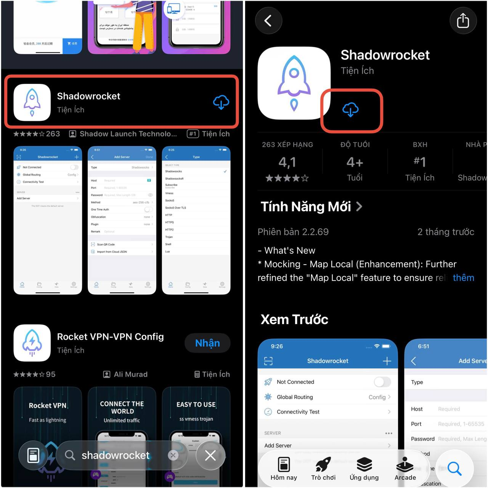
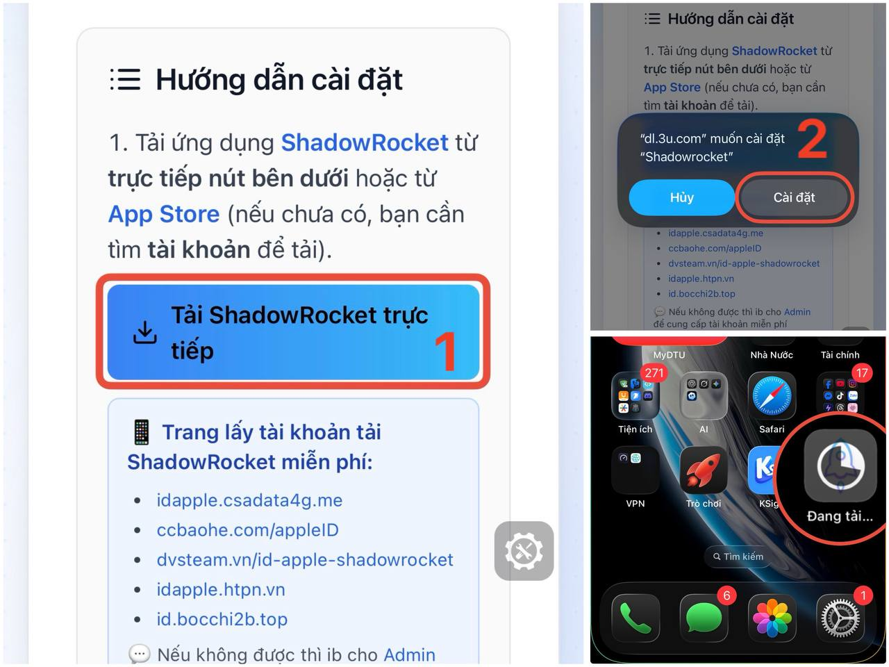
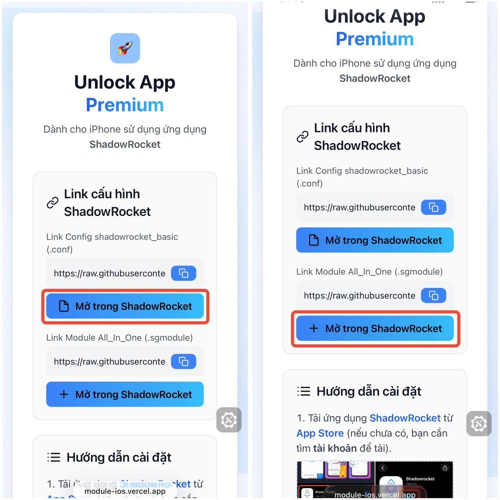
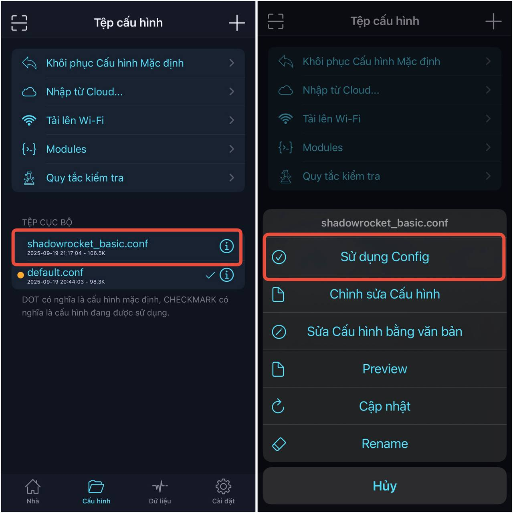
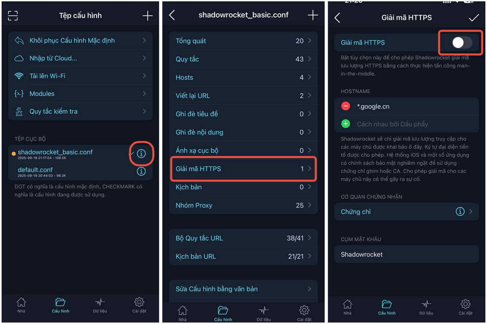
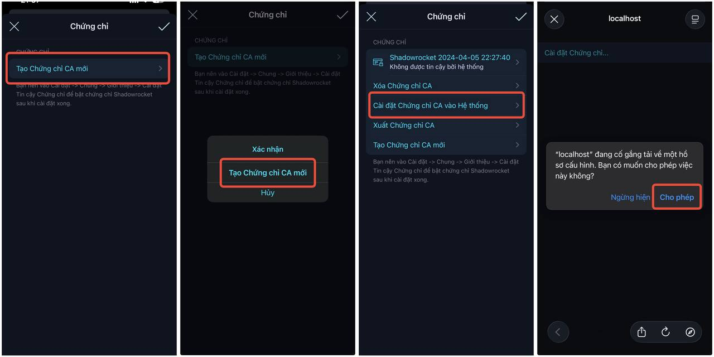
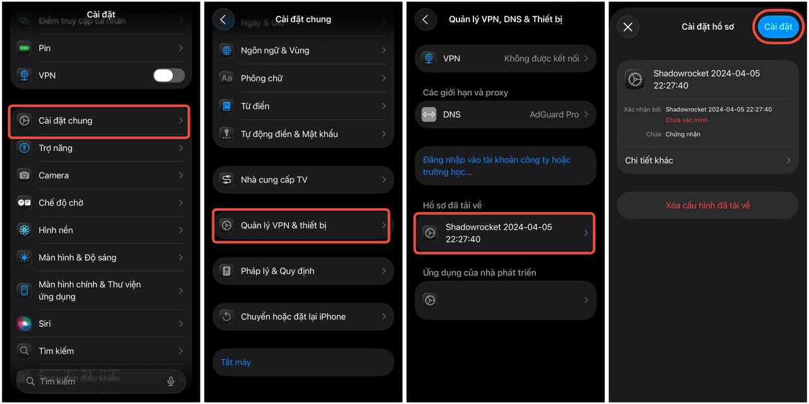
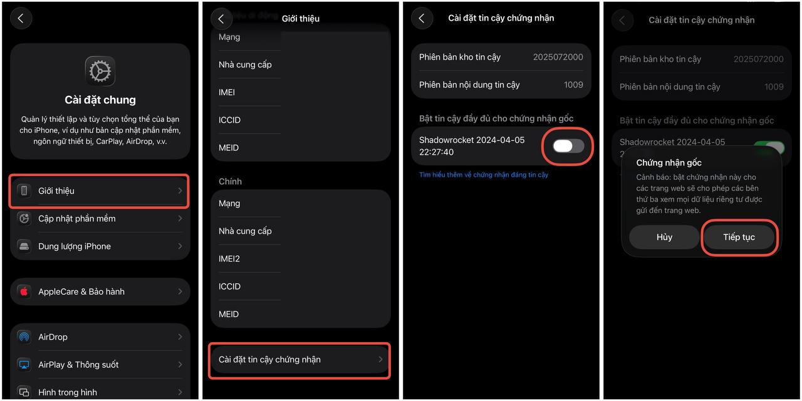
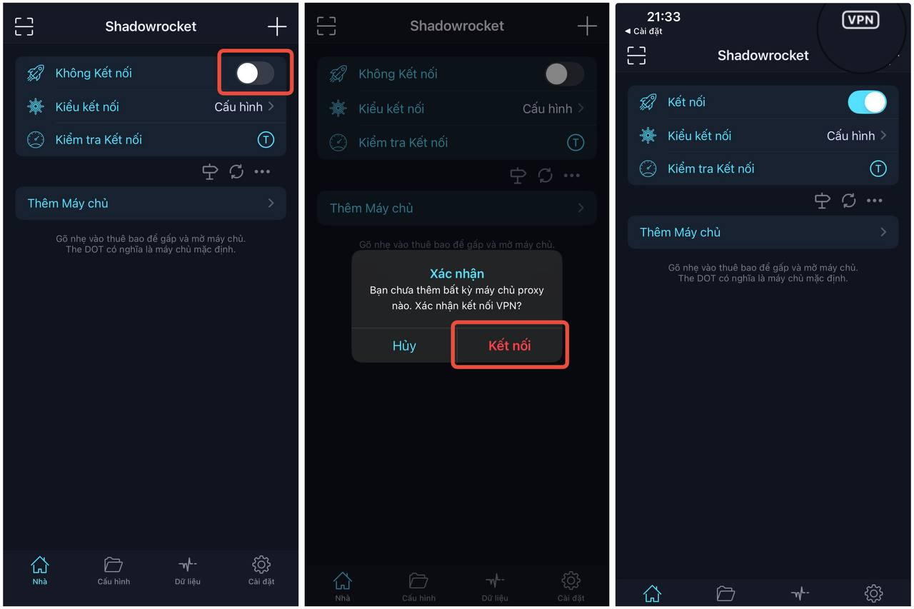

<p align="center">
  <a href="https://raw.githubusercontent.com/duyvinh09/Module_IOS/refs/heads/main/All_In_One.sgmodule" title="All-in-One module">
    
  </a>
  <a href="https://apps.apple.com/app/shadowrocket/id932747118" title="Shadowrocket trên App Store">
    
  </a>
  <a href="https://github.com/duyvinh09" title="GitHub của tác giả">
    
  </a>
</p>

<p align="center">
  <a href="./README.md">Read in English</a>
</p>

<h1 align="center">Module IOS cho Shadowrocket</h1>

<p align="center">
  Bộ cấu hình và module dành cho Shadowrocket trên iOS, hỗ trợ mở khóa các tính năng
  <strong>Premium / Pro / VIP</strong> của những ứng dụng được dự án hỗ trợ.
</p>

> [!IMPORTANT]
> Dự án chỉ cung cấp cấu hình kỹ thuật để phục vụ mục đích học tập và tham khảo.
> Hãy sử dụng với ứng dụng, tài khoản và nội dung mà bạn có quyền sử dụng; đồng thời
> tuân thủ điều khoản của Shadowrocket, App Store và từng ứng dụng.

## Nội dung

- [Giới thiệu](#giới-thiệu)
- [Yêu cầu](#yêu-cầu)
- [Cài đặt Shadowrocket](#cài-đặt-shadowrocket)
- [Cài đặt nhanh All-in-One](#cài-đặt-nhanh-all-in-one)
- [Cấu hình thủ công từng bước](#cấu-hình-thủ-công-từng-bước)
- [Ứng dụng được hỗ trợ](#ứng-dụng-được-hỗ-trợ)
- [Tài nguyên trong repository](#tài-nguyên-trong-repository)
- [Xử lý sự cố](#xử-lý-sự-cố)
- [Đóng góp](#đóng-góp)

## Giới thiệu

Repository này tập hợp các file `.conf`, `.sgmodule`, `.js` và một số cấu hình
liên quan để sử dụng với [Shadowrocket](https://apps.apple.com/app/shadowrocket/id932747118).
Các rule/module can thiệp vào request của ứng dụng thông qua proxy cục bộ của
Shadowrocket. Khi cấu hình phù hợp và VPN đang bật, tính năng được hỗ trợ có thể
được kích hoạt trong ứng dụng tương ứng.

Trang hướng dẫn trực quan có sẵn tại [`index.html`](./index.html). README này
giải thích cách cài đặt theo từng bước để có thể tham khảo ngay cả khi không mở
trang web.

## Yêu cầu

- iPhone/iPad chạy iOS và đã cài Shadowrocket.
- Kết nối Internet ổn định.
- Quyền cài chứng chỉ CA trên thiết bị nếu sử dụng HTTPS Decryption.
- Không cài đồng thời nhiều module có cùng mục đích hoặc cùng rule, vì có thể
  gây xung đột.

## Cài đặt Shadowrocket

### Cách 1: Tải từ App Store (khuyến nghị)

Mua và cài [Shadowrocket trên App Store](https://apps.apple.com/app/shadowrocket/id932747118).
Đây là cách chính thức và ổn định nhất để nhận bản cập nhật từ nhà phát triển.



### Cách 2: Cài thông qua 3uTools

Nếu không thể tải từ App Store, có thể dùng máy tính Windows và
[3uTools](https://www.3u.com/) theo quy trình sau:

1. Cài 3uTools trên máy tính.
2. Kết nối iPhone bằng cáp USB, chọn **Tin cậy máy tính này?** trên iPhone và
   nhập mật mã nếu được yêu cầu.
3. Chờ 3uTools nhận thiết bị và cài ứng dụng 3uTools trên iPhone theo hướng dẫn
   của phần mềm.
4. Mở 3uTools trên iPhone, tìm `Shadowrocket` và chọn cài đặt.

> [!WARNING]
> Nút cài đặt trực tiếp trong trang hướng dẫn chỉ hoạt động khi thiết bị đã
> được 3uTools hỗ trợ/khởi tạo trước đó. Nếu không chạy, hãy cài Shadowrocket
> từ bên trong ứng dụng 3uTools sau khi kết nối iPhone với máy tính.
>
> Không đăng nhập tài khoản không rõ nguồn gốc vào iCloud. Nếu cần dùng tài
> khoản khác để tải ứng dụng, chỉ sử dụng trong App Store và đăng xuất sau khi
> hoàn tất.

Ảnh minh họa quá trình chuẩn bị và tải Shadowrocket:



## Cài đặt nhanh All-in-One

`All_In_One` là lựa chọn thuận tiện nếu muốn sử dụng nhiều rule/module trong
một lần cài đặt.

### Config (`.conf`)

Config dùng để nạp cấu hình chính của Shadowrocket:

```text
https://raw.githubusercontent.com/duyvinh09/Module_IOS/refs/heads/main/All_In_One.conf
```

### Module (`.sgmodule`)

Module dùng để thêm các rule/script vào cấu hình đang sử dụng:

```text
https://raw.githubusercontent.com/duyvinh09/Module_IOS/refs/heads/main/All_In_One.sgmodule
```

Trong Shadowrocket, có thể mở trực tiếp bằng các liên kết sau:

- [Mở All_In_One.conf trong Shadowrocket](shadowrocket://config/add/https://raw.githubusercontent.com/duyvinh09/Module_IOS/refs/heads/main/All_In_One.conf)
- [Cài All_In_One.sgmodule trong Shadowrocket](shadowrocket://install?module=https%3A%2F%2Fraw.githubusercontent.com%2Fduyvinh09%2FModule_IOS%2Frefs%2Fheads%2Fmain%2FAll_In_One.sgmodule)

> Nếu liên kết `shadowrocket://` không mở được, hãy sao chép URL và thêm thủ công
> trong tab **Cấu hình**.

## Cấu hình thủ công từng bước

Các bước dưới đây áp dụng cho `All_In_One.conf` và `All_In_One.sgmodule`.
Tên menu có thể thay đổi nhẹ tùy phiên bản iOS hoặc Shadowrocket.

### 1. Nhập config và module

Trong Shadowrocket, mở tab **Cấu hình**:

1. Nhấn dấu **+**.
2. Dán URL `All_In_One.conf` để tải config.
3. Nhấn dấu **+** lần nữa và thêm URL `All_In_One.sgmodule`.



### 2. Chọn config đang sử dụng

Chọn cấu hình `All_In_One.conf` vừa tải, sau đó nhấn **Sử dụng Config**.



### 3. Bật HTTPS Decryption

Nhấn biểu tượng thông tin màu xanh bên cạnh `All_In_One.conf`, mở
**Giải mã HTTPS (HTTPS Decryption)** và bật tính năng này.



### 4. Tạo và cài chứng chỉ CA

Khi Shadowrocket yêu cầu chứng chỉ, chọn lần lượt:

1. **Tạo chứng chỉ CA mới**.
2. **Cài đặt Chứng chỉ CA vào Hệ thống**.
3. Chọn **Cho phép**, sau đó **Đóng**.



### 5. Cài chứng chỉ trong phần Cài đặt của iPhone

Mở **Cài đặt** → **Cài đặt chung** → **Quản lý VPN & Thiết bị**, sau đó chọn
và cài chứng chỉ vừa tạo.



### 6. Tin cậy chứng chỉ

Mở **Cài đặt** → **Cài đặt chung** → **Giới thiệu** →
**Cài đặt tin cậy chứng nhận**, bật chứng chỉ của **Shadowrocket** và xác nhận.



### 7. Bật kết nối

Quay lại Shadowrocket, chuyển về tab **Nhà** và bật **Kết nối**. Khi biểu tượng
**VPN** xuất hiện trong Trung tâm điều khiển, cấu hình đã hoạt động.



## Ứng dụng được hỗ trợ

Danh sách dưới đây được tổng hợp từ trang hướng dẫn và có thể thay đổi theo
phiên bản ứng dụng, máy chủ hoặc rule hiện tại:

| Ứng dụng | Tính năng tham khảo |
| --- | --- |
| Alight Motion | Pro, loại bỏ watermark |
| BeautyPlus | Tính năng VIP |
| CamScanner | Tính năng VIP |
| KineMaster | Pro, loại bỏ watermark |
| Lightroom | Tính năng Premium (cần tài khoản Lightroom đã từng lên Pro) |
| Locket | Locket Gold Unlocket full tính năng mà Gold thường không có |
| PicsArt | Công cụ Premium |
| Snow | VIP |
| SoundCloud | Go+ |
| Spotify | Giảm quảng cáo, tính năng âm thanh |
| VSCO | Filter và công cụ Studio |
| Wink | Tính năng VIP |
| Truecaller | Gold và caller ID |
| YouTube | Chặn quảng cáo, phát nền |

> Kết quả không được đảm bảo cho mọi phiên bản ứng dụng. Nếu nhà cung cấp thay
> đổi API hoặc cơ chế xác thực, module có thể cần được cập nhật.

## Tài nguyên trong repository

```text
.
├── All_In_One.conf              # Config tổng hợp cho Shadowrocket
├── All_In_One.sgmodule          # Module tổng hợp
├── shadowrocket_basic.conf      # Config cơ bản
├── modules/                     # Module riêng cho từng ứng dụng/tính năng
├── js/                          # Script xử lý request/response
├── assets/steps/                # Ảnh hướng dẫn cài đặt
├── assets/*.mobileconfig        # Cấu hình bổ sung
└── index.html                   # Trang hướng dẫn trực quan
```

Một số module riêng:

- [Locket](./modules/Locket_duyvinh09.sgmodule)
- [BeautyPlus](./modules/BeautyPlus.sgmodule)
- [Camera360](./modules/Camera360.sgmodule)
- [SODA](./modules/SODA.sgmodule)
- [Snow](./modules/snow.sgmodule)
- [iOS Location Spoofer](./modules/ios-location-spoofer.sgmodule)
- [iTunes](./modules/itunes.sgmodule)

Khi chỉ cần một ứng dụng, ưu tiên cài module riêng thay vì `All_In_One` để
giảm số rule và hạn chế xung đột.

## Xử lý sự cố

### Module đã cài nhưng không có tác dụng

- Kiểm tra Shadowrocket đang **Kết nối** và biểu tượng VPN đang hiển thị.
- Kiểm tra module đã được bật trong cấu hình đang sử dụng.
- Đóng hoàn toàn ứng dụng cần áp dụng, sau đó mở lại.
- Cập nhật lại module từ URL raw của repository.
- Kiểm tra phiên bản ứng dụng có nằm trong phạm vi tương thích hay không.

### HTTPS Decryption không hoạt động

- Đảm bảo đã tạo và cài chứng chỉ CA trong Shadowrocket.
- Đảm bảo đã bật tin cậy chứng chỉ tại **Cài đặt tin cậy chứng nhận**.
- Nếu đã đổi hoặc xóa chứng chỉ, tạo lại chứng chỉ mới rồi thực hiện lại các
  bước cài đặt.

### Ứng dụng không có mạng sau khi bật VPN

- Tắt các module không cần thiết để tìm rule gây xung đột.
- Thử chuyển sang config cơ bản hoặc tắt module riêng vừa cài.
- Tắt Shadowrocket khi không sử dụng để tránh hao pin và ảnh hưởng kết nối.

## Đóng góp

Issue và pull request được hoan nghênh. Khi gửi thay đổi, vui lòng:

1. Mô tả ứng dụng và phiên bản iOS/ứng dụng đã kiểm tra.
2. Nêu rõ file config/module/script bị ảnh hưởng.
3. Không đưa thông tin cá nhân, token, tài khoản hoặc dữ liệu nhạy cảm vào
   repository.
4. Kiểm tra lại cú pháp rule và cập nhật hướng dẫn nếu thay đổi quy trình cài
   đặt.

## Ủng hộ dự án

Nếu repository này hữu ích với bạn, sự ủng hộ của cộng đồng sẽ giúp dự án được
duy trì và cải thiện lâu dài:

- ⭐ **Star repository** để đánh dấu và giúp dự án được nhiều người biết đến.
- 🐞 **Tạo Issue** khi phát hiện lỗi hoặc cần báo cáo vấn đề.
- 🤝 **Gửi Pull Request** để đề xuất tính năng, sửa lỗi hoặc cải thiện tài liệu.

## Liên kết

- [Trang hướng dẫn trực quan](./index.html)
- [Shadowrocket trên App Store](https://apps.apple.com/app/shadowrocket/id932747118)
- [Trang chính thức 3uTools](https://www.3u.com/)
- [GitHub duyvinh09](https://github.com/duyvinh09)

## Giấy phép

Repository hiện chưa khai báo giấy phép sử dụng. Nếu bạn muốn fork, phân phối
hoặc tích hợp các file trong dự án, hãy liên hệ tác giả để xác nhận quyền sử
dụng và phạm vi phân phối.

<p align="center">
  Made with ❤️ for the iOS automation community by
  <a href="https://github.com/duyvinh09">Đinh Duy Vinh</a>
</p>
